# follow-and-ground

> **Please read this first.** This tool was made by someone who is not a doctor, therapist or clinician. It is a simple
> practice tool built after reading about EMDR, and it makes no claims that it helps with anything.
> **It is not a replacement for therapy.** If you find it useful, use it, but please also talk to someone: a therapist,
> your doctor, a friend, or a crisis line. If you're struggling, call or text **988** (US) or find a line near you at
> [findahelpline.com](https://findahelpline.com). You don't have to work through anything alone, and an app shouldn't
> be the only thing you lean on.

## What it is

A small desktop app (Windows, macOS, Linux) that runs a self-guided **practice and grounding** session, borrowing a few ideas from EMDR research: a
calm place exercise, an object that moves around a quiet 3D room for you to follow with your eyes, a 0-10 rating of how
upsetting a memory feels after each set, and a closing grounding exercise. A spoken guide talks you through it.

**This is not EMDR therapy.** EMDR (Eye Movement Desensitization and Reprocessing) is a therapy delivered by trained,
licensed clinicians. This app borrows a few of its outward pieces for gentle practice with mild, everyday memories
only. It is not a medical device and does not diagnose, treat or prevent any condition. No licensed EMDR clinician has
reviewed the script or the flow. See [References](#references) for what researchers say, including their caution about
doing this on your own.

- **One download, no install.** Run it, use it, delete it when you're done.
- **Nothing leaves your computer.** No account, no internet connection, no tracking. The voice is your computer's own
  offline text-to-speech. Your ratings are kept in a small file on your machine that you can delete from inside the app.
- **Free and open.** MIT licensed. See [PHILOSOPHY.md](PHILOSOPHY.md) for why it's built this way.

## Download

Get the latest build from the [Releases](../../releases) page:

| System | File | How to run |
|---|---|---|
| Windows | `follow-and-ground-windows.zip` | Unzip, double-click `follow-and-ground.exe`. Windows may warn about an unknown publisher: **More info > Run anyway**. |
| macOS | `follow-and-ground-macos.zip` | Unzip, then right-click the app > **Open**. It isn't signed by Apple, so a plain double-click is blocked the first time. |
| Linux | `follow-and-ground-linux.zip` | Unzip, `chmod +x follow-and-ground.x86_64`, run it. |

To remove it, delete the file. To also remove your saved ratings, use **Delete my data** first, or delete the
`follow-and-ground` folder under `%APPDATA%\Godot\app_userdata\` (Windows), `~/Library/Application Support/Godot/app_userdata/`
(macOS) or `~/.local/share/godot/app_userdata/` (Linux).

## What to expect (walkthrough)

You can press **Stop / Ground me** or **Esc** at any point, and it always takes you straight to grounding. The crisis
lines stay at the bottom of every screen.

**1. Before you start.** Read the note and choose your options: the object, how it moves, background noise, speed, set
length and voice. Tick the box to say you understand this is not therapy. **Begin** stays locked until you do.

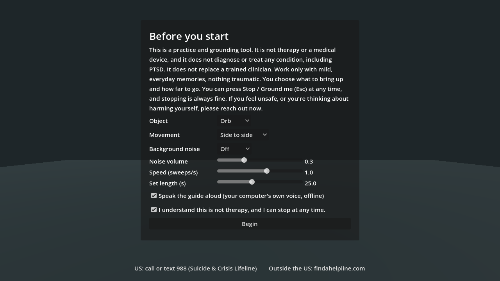

**2. Calm place.** The guide helps you picture somewhere you feel safe and settled. You come back here at the end.

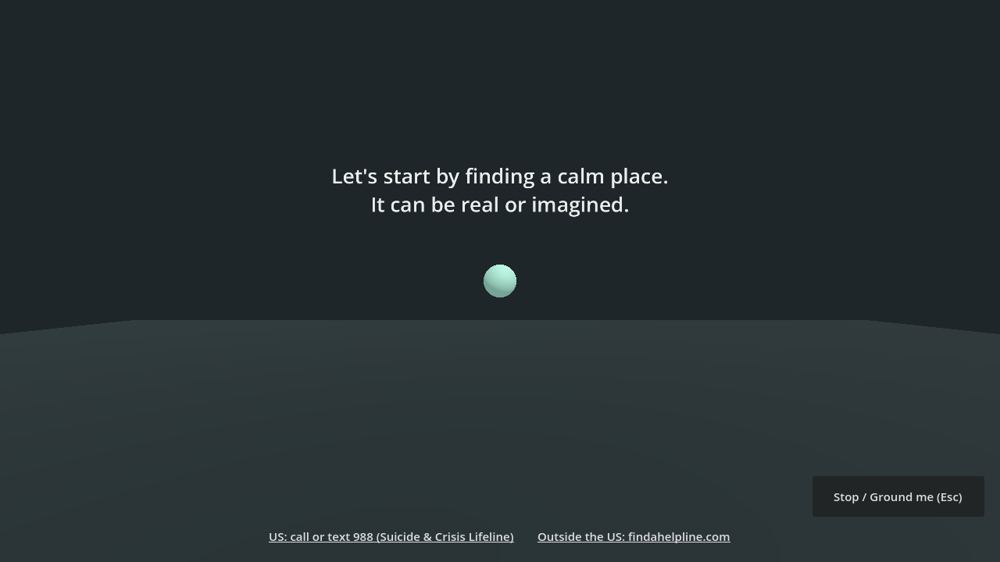

**3. Pick a small memory.** Only if you want to, and only something mildly bothersome. Nothing traumatic.

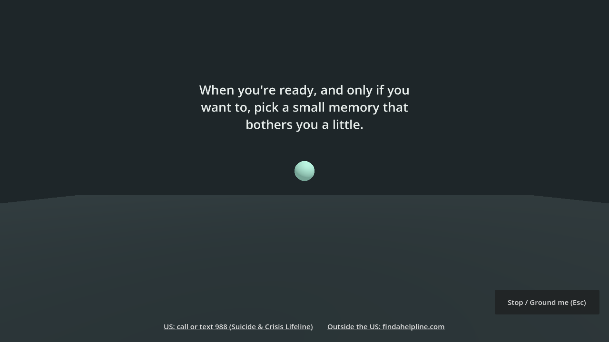

**4. Rate it.** How upsetting does it feel, 0 to 10? Click a number or press a key. You'll be asked again after each set.

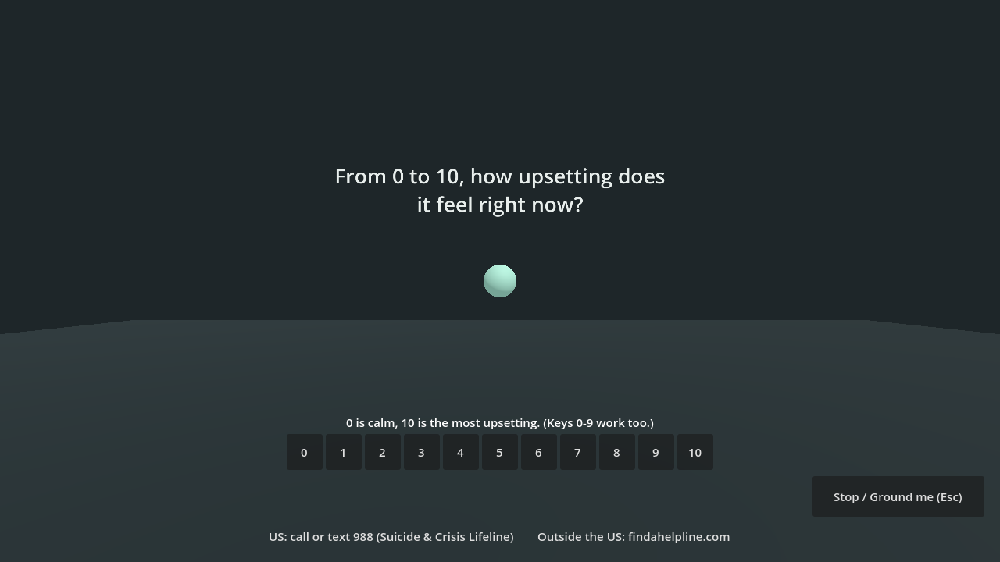

**5. Follow the object.** It glides around in front of you for about 25 seconds. Follow it with your eyes and notice
whatever comes up. Then you rate again.

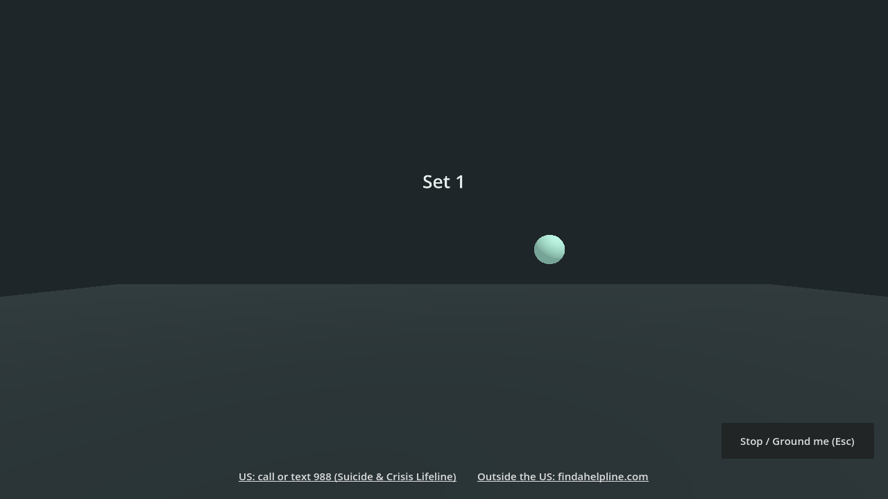

You can pick the object and how it moves: side to side, a figure eight, a circle, or drifting near and far. Some
therapists use a puppet or a small object instead of a finger, so there's a little "buddy" figure as well as an orb and
a ring.

| Buddy, figure eight | Ring, near and far |
|---|---|
| 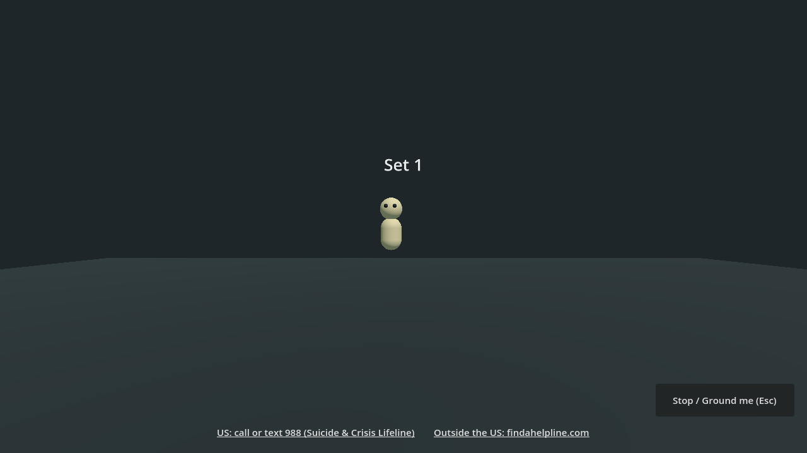 | 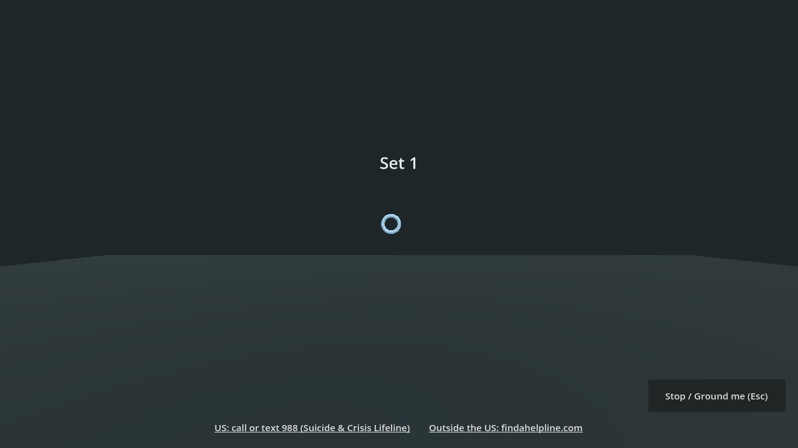 |

**Background noise (optional).** White, pink or brown noise. During a set it pans left and right with the object, so
with headphones the sound moves side to side too. Some people find it calming; leave it off if you don't.

**6. If it gets heavy.** A rating of 8 or more asks whether you want to ground or keep going. If it stays that high,
it grounds you without asking.

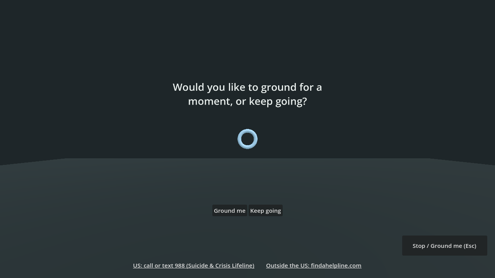

**7. Grounding.** A short exercise to bring you back to the room: what you can see, hear and feel right now, and some
slow breaths.

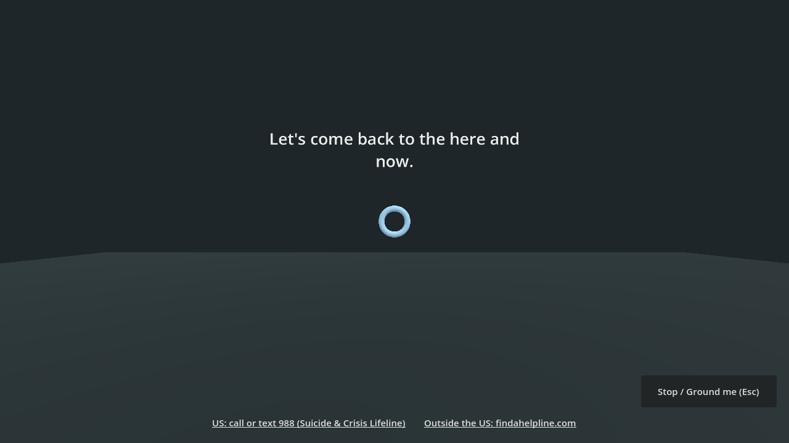

**8. The end.** A reminder that if anything stays with you, talk to someone you trust or a professional.

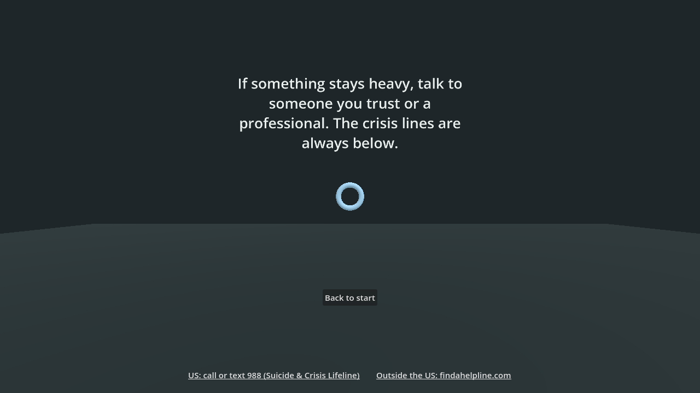

**Your ratings** show on the first screen next time, with a **Delete my data** button.

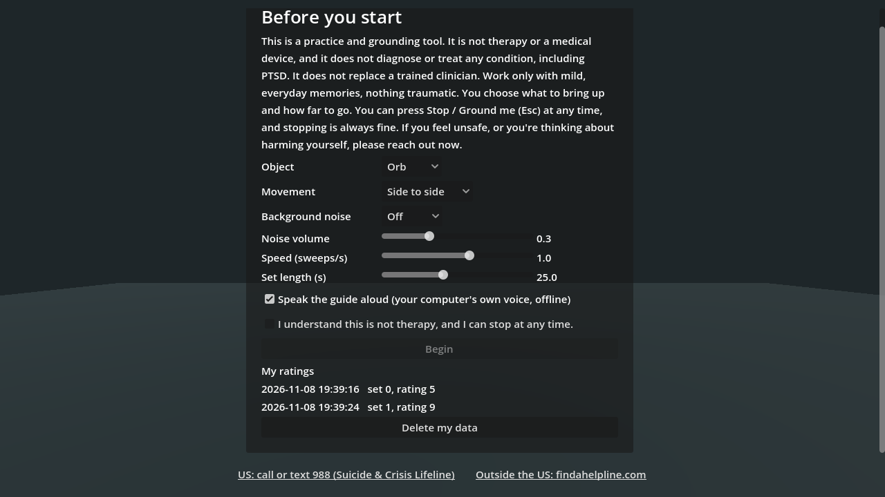

## VR (experimental)

The app uses OpenXR. If a VR runtime is running (SteamVR, Meta Quest Link, or a simulator such as the Meta XR
Simulator), it opens in the headset and the object moves around you in the room. With no headset it opens as a normal
window. **VR has not been tried in a real headset yet**, and in VR the ratings and buttons still use the desktop window
(keys 0-9, Esc).

## References

Why the app is built the way it is. These sources describe what researchers and professional bodies say about EMDR
**therapy** and related techniques. None of them looked at this app, and nothing here claims the app works. EMDR is
delivered by trained clinicians; this app is not EMDR.

- **Shapiro, F. (2014).** The role of eye movement desensitization and reprocessing (EMDR) therapy in medicine:
  addressing the psychological and physical symptoms stemming from adverse life experiences. *The Permanente Journal*,
  18(1), 71-77. [doi:10.7812/TPP/13-098](https://doi.org/10.7812/TPP/13-098)
  ([free full text](https://pmc.ncbi.nlm.nih.gov/articles/PMC3951033/))<br>
  *What it says:* A review by EMDR's creator. It describes EMDR as an eight-phase treatment with standardized protocols,
  one part of which uses "dual attention stimuli in the form of bilateral eye movements, taps, or tones." It presents
  several proposed explanations for how it works (working memory, an orienting response, links to REM sleep) as
  hypotheses, and stresses treatment fidelity. Worth knowing: it's written by the method's developer, not an independent
  reviewer.
- **EMDR International Association.** [About EMDR Therapy](https://www.emdria.org/about-emdr-therapy/).<br>
  *What it says:* EMDR is an eight-phase therapy using guided bilateral stimulation, and it "should only be offered by
  properly trained and licensed mental health clinicians." That's why this app doesn't call itself EMDR, or use it in its name.
- **World Health Organization (2013).** [*Guidelines for the management of conditions specifically related to
  stress*](https://www.who.int/publications/i/item/9789241505406), and WHO's
  [news release about them](https://www.who.int/news/item/06-08-2013-who-releases-guidance-on-mental-health-care-after-trauma).<br>
  *What it says:* "Referral for advanced treatments such as cognitive-behavioural therapy (CBT) or a new technique called
  eye movement desensitization and reprocessing (EMDR) should be considered for people suffering from PTSD." In other
  words, a referral to a treatment, not a self-help exercise.
- **Lee, C. W., & Cuijpers, P. (2013).** A meta-analysis of the contribution of eye movements in processing emotional
  memories. *Journal of Behavior Therapy and Experimental Psychiatry*, 44(2), 231-239.
  [doi:10.1016/j.jbtep.2012.11.001](https://doi.org/10.1016/j.jbtep.2012.11.001)<br>
  *What it says:* A meta-analysis of 15 clinical trials (EMDR with vs. without the eye movements) and 11 lab studies (849
  people in total). Adding eye movements had a moderate effect in the therapy studies (d = 0.41) and a large one in the
  lab studies (d = 0.74). This is why following a moving object is the centre of the app.
- **van den Hout, M. A., Engelhard, I. M., Rijkeboer, M. M., Koekebakker, J., Hornsveld, H., Leer, A., Toffolo, M. B., &
  Akse, N. (2011).** EMDR: Eye movements superior to beeps in taxing working
  memory and reducing vividness of recollections. *Behaviour Research and Therapy*, 49(2), 92-98.
  [doi:10.1016/j.brat.2010.11.003](https://doi.org/10.1016/j.brat.2010.11.003)<br>
  *What it says:* In lab experiments, eye movements taxed working memory much more than beeps did. With healthy
  volunteers, both beeps and eye movements made negative memories less vivid, but eye movements had the larger effect.
  This is why the moving object comes first and the panning noise is only an option.
- **Waterman, L. Z., & Cooper, M. (2020).** Self-administered EMDR therapy: potential solution for expanding the
  availability of psychotherapy for PTSD or unregulated recipe for disaster? *BJPsych Open*, 6(6), e115.
  [doi:10.1192/bjo.2020.92](https://doi.org/10.1192/bjo.2020.92)
  ([free full text](https://pmc.ncbi.nlm.nih.gov/articles/PMC7576659/))<br>
  *What it says:* A commentary weighing the possible benefits and risks of self-guided EMDR. The authors searched the
  research and found only one small study. People in it reported fewer symptoms of PTSD, depression, anxiety and
  distress three months later, with no serious adverse events, but the study had substantial methodological problems.
  They note that self-help therapies in general can be safe, effective and easy to reach, but that experts still
  disagree about whether self-guided EMDR is safe or effective, and that better research is needed.
  **That open question is why this app keeps to mild memories, grounds you at high ratings, and keeps pointing to
  trained help.**

The 5-4-3-2-1 grounding and slow-breathing steps at the end are common coping exercises, not taken from a specific study.

## Building from source

Needs [Godot 4.7](https://godotengine.org/) with its export templates.

```
godot --headless --path . -s tools/selftest.gd     # session rules, object paths, noise levels
godot --path . -s tools/shots.gd                   # regenerate docs/screenshots
godot --headless --path . --export-release Windows build/windows/follow-and-ground.exe
godot --headless --path . --export-release Linux   build/linux/follow-and-ground.x86_64
godot --headless --path . --export-release macOS   build/macos/follow-and-ground.zip
```

Every line the guide says is in [`scripts/guide.gd`](scripts/guide.gd), so you can review the wording in one place.
The session rules (when it grounds you, when it ends) are in [`scripts/core.gd`](scripts/core.gd).

## License

MIT (see `LICENSE`).
